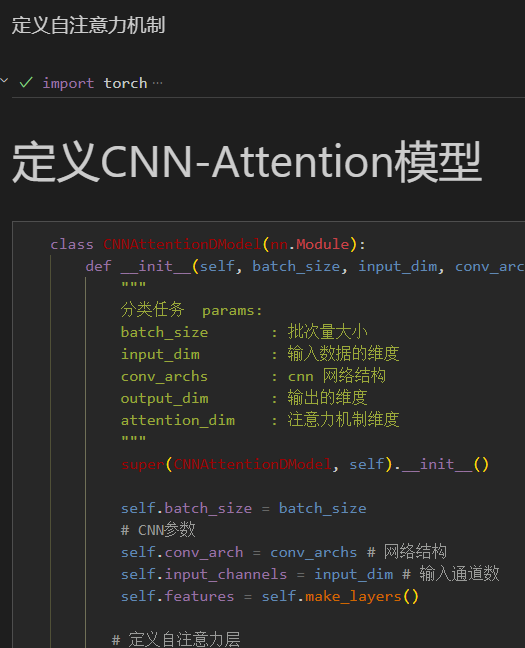
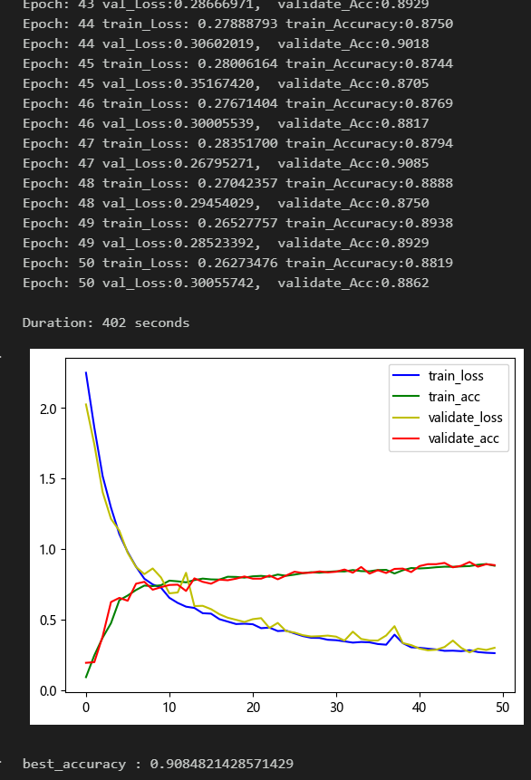
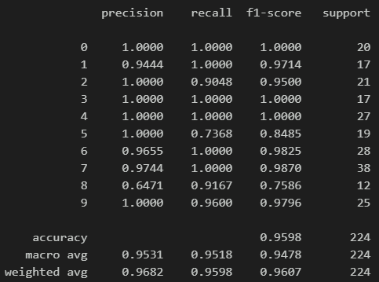
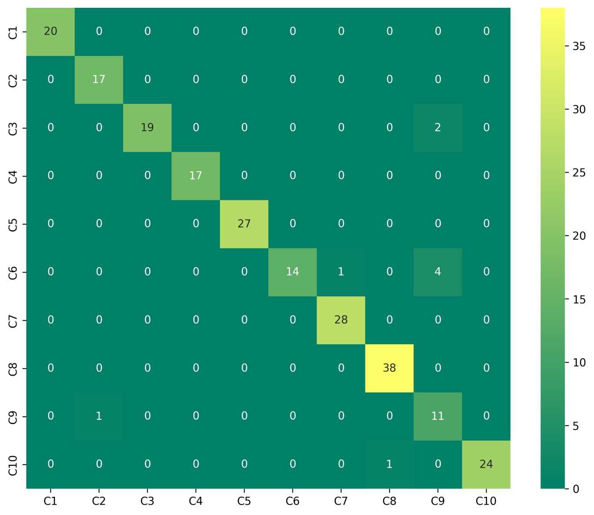
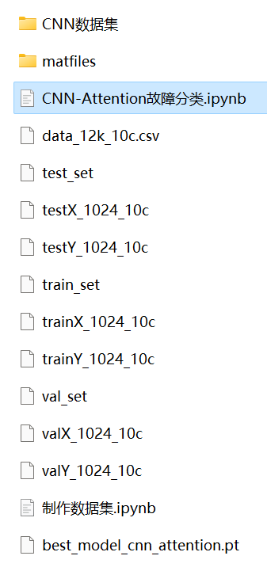

# Bearing Fault Diagnosis - CNN-Attention Fault Classification Model

The dataset includes a complete CWRU bearing fault dataset, as well as a pre-generated fault signal dataset, classification data set, and label set. The corresponding code can be run successfully.

50 epochs, with an accuracy of 97%. The classification effect of the CNN-Attention network is significant. The model can fully extract spatial, temporal, and frequency domain features of bearing fault signals. It converges quickly and has excellent performance and high precision. Innovation is also present!!!

The code for data preprocessing and the CNN-Attention classification code are included.
Environment: Python 3.9, PyTorch 1.8 or above.
Preface:
This article is based on the bearing data from Case Western Reserve University (CWRU). After data preprocessing, the dataset is created and loaded, and finally, the CNN-Attention model is used to classify the fault data through PyTorch.
A detailed introduction to the CWRU bearing data can be found in the following article:
Python-Case Western Reserve University (CWRU) Bearing Data Interpretation and Classification Processing
1. Bearing Data Loading and Preprocessing
1.1 Import Data
Refer to the previous article for the preprocessing of fault 10 classification, and the CWRU bearing data 10 classification dataset:
train_set, val_set, test_set are all divided into training set, validation set, and test set according to the ratio of 7:2:1, and finally save the data.
The figure shows the reading form of the data and the preprocessing idea.
1.2 Data Preprocessing, Making the Dataset
2. Based on Pytorch's CNN-Attention Diagnosis Model
2.1 Define the CNN-Attention classification network model
2.2 Set parameters and train the model
50 epochs, with an accuracy nearing 90%, the CNN-Attention network significantly improves classification performance. The CNN-Attention model can fully extract multi-scale features of bearing fault signals, has a fast convergence speed, and is exceptionally superior in performance, achieving significant results.

Note to adjust parameters:
- Increase the number of CNN layers and the dimensionality per layer, and fine-tune learning rates;
- Tune the attention dimensionality, increase more epochs (be cautious to prevent overfitting);
- Change the shape of one-dimensional signal stacking (set appropriate length and dimension);
- 2.3 Model evaluation
- Accuracy, Precision, Recall, F1 Score
- Fault classification confusion matrix:
- Previously excellent content:
- Python-Case Western Reserve University (CWRU) bearing data interpretation and classification processing
- Python bearing fault diagnosis (I) Short-time Fourier Transform STFT
- Python bearing fault diagnosis (II) Continuous Wavelet Transform CWT
- Python bearing fault diagnosis (III) Empirical Mode Decomposition EMD
- Pytorch-LSTM bearing fault one-dimensional signal classification (I)
- Pytorch-CNN bearing fault one-dimensional signal classification (II)
- Pytorch-Transformer bearing fault one-dimensional signal classification (III)
- Python bearing fault diagnosis (IV) Based on EMD-CNN fault classification
- Python bearing fault diagnosis (V) Based on EMD-LSTM fault classification
- Python bearing fault diagnosis (VI) Based on EMD-Transformer fault classification
- Python bearing fault diagnosis (VII) Based on EMD-CNN-LSTM fault classification
- Python bearing fault diagnosis (VIII) Based on EMD-CNN-GRU parallel model fault classification
Bearing Fault Identification Model Based on FFT + CNN - BiGRU-Attention for Time and Frequency Feature Attention Fusion
Bearing Fault Identification Model Based on FFT + CNN - Transformer Time-Domain and Frequency-Domain Feature Fusion
Python Bearing Fault Diagnosis (IX) Fault Classification Based on VMD+CNN-BiLSTM
Python Bearing Fault Diagnosis (10) Fault Classification Based on VMD+CNN-Transformer
Python Bearing Fault Diagnosis (11) Based on VMD+CNN-BiGRU-Attenion for Fault Classification
Cross Attention FFT + CNN - BiLSTM-CrossAttention Bearing Fault Identification Model
Cross Attention Fusion of Time-Domain and Frequency-Domain Features for Bearing Failure Identification Model with FFT + CNN-Transformer-CrossAttention
Python Bearing Fault Diagnosis Beginner Tutorial
Python Bearing Fault Diagnosis (13) Super-strong Machine Learning Recognition Model Based on Fault Signal Feature Extraction
Python Bearing Fault Diagnosis (14) High-Innovation Fault Identification Model
Python Bearing Fault Diagnosis (15) One-Dimensional Fault Signal Recognition Model Based on CNN-Transformer
Python Bearing Fault Diagnosis (16) High-Innovation Fault Identification Model (II)
| SCI 1 Zone High-Innovation Bearing Fault Diagnosis Model!
Python Bearing Fault Diagnosis (18) - Innovative Diagnosis Model Based on CNN-TCN-Attention
High-Innovation Bearing Fault Diagnosis Model Based on GADF+Swin-CNN-GAM
Attention Magic Mod | Superb Bearing Fault Diagnosis Model!
END  
2. Friends who enjoy the content can follow, give the article a "like", share on social media or discuss in groups.

## Images

<!-- PAYMENT_BLOCK -->

## Get this dataset

- Payment link (Stripe): [Buy now](https://buy.stripe.com/3cs8yP7sY87d0vu9AB)
- Payment QR code: 

<!-- /PAYMENT_BLOCK -->
